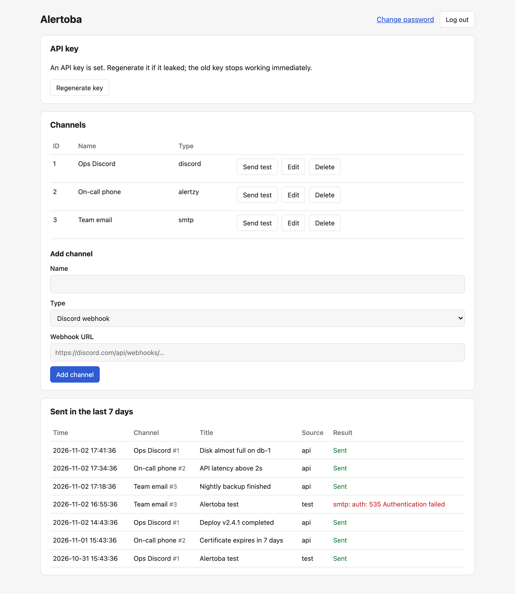
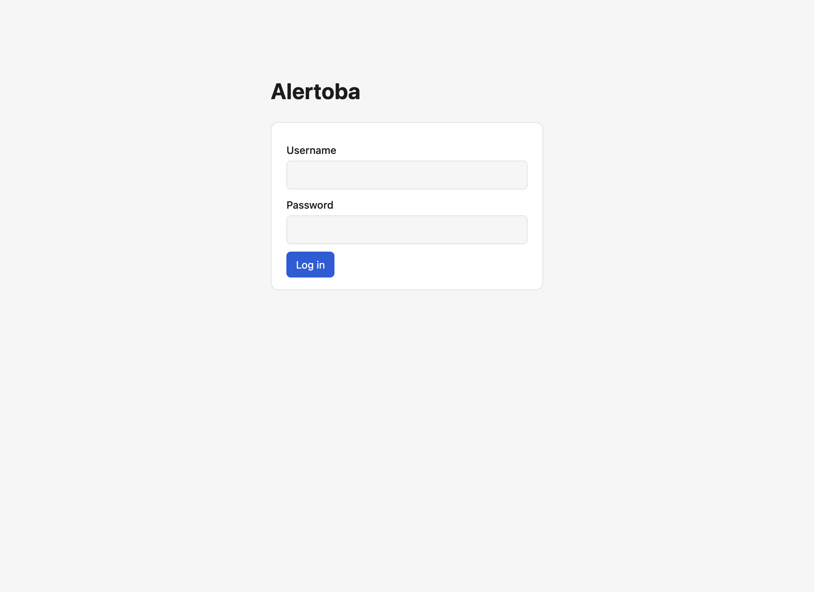
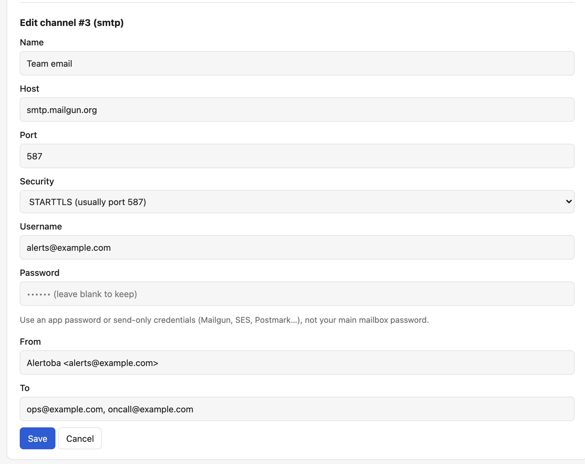
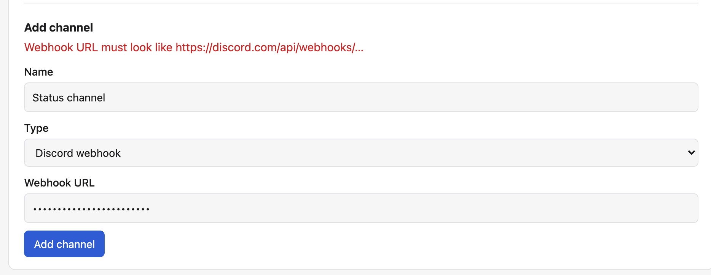
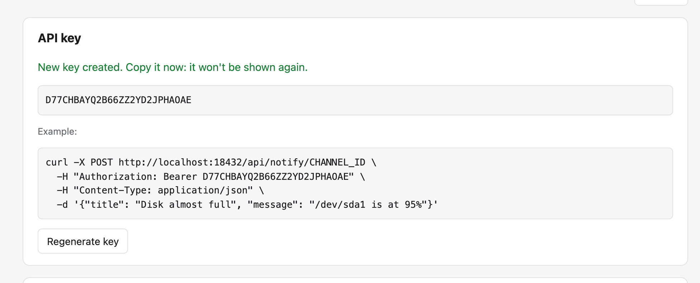
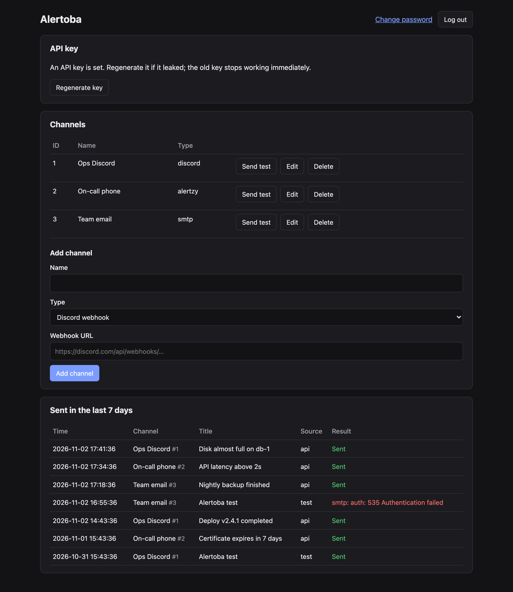

# Alertoba

A small, self-hosted alert relay. You set up notification channels (Discord
webhooks, Alertzy push notifications, and SMTP email) in a web dashboard,
and your scripts, cron jobs and services trigger them with one HTTP call.

```bash
curl -X POST https://alerts.example.com/api/notify/1 \
  -H "Authorization: Bearer $ALERTOBA_KEY" \
  -H "Content-Type: application/json" \
  -d '{"title": "Disk almost full", "message": "/dev/sda1 is at 95%"}'
```



## Features

- **Three channel types**: Discord webhook, [Alertzy](https://alertzy.app) push, and SMTP email (STARTTLS or TLS).
- **One API call to send**: `POST /api/notify/{channel_id}` with a title and message.
- **Web dashboard** (htmx): add, edit, delete and test channels, manage the API key, and see what was sent.
- **Send log**: every send from the last 7 days, with errors. Older entries are deleted automatically.
- **Encrypted database**: the whole SQLite file is encrypted at rest.
- **Easy to deploy**: one Go file, one binary, no C compiler. Docker images are published for amd64 and arm64.

## Quick start

First generate a database key, once, and **save it** in a password manager or
secrets store. Every start needs the same key, and the data can't be
recovered without it.

```bash
openssl rand -base64 32
```

### Docker

```bash
docker run -d --name alertoba \
  -p 8080:8080 \
  -e DB_KEY="<your saved key>" \
  -v alertoba-data:/data \
  ghcr.io/codeoba-org/alertoba:latest
```

### Binary

Download the binary for your OS from the
[latest release](https://github.com/codeoba-org/alertoba/releases/latest), then:

```bash
export DB_KEY="<your saved key>"
./alertoba-linux-amd64
```

On macOS the binaries aren't signed. Clear the download quarantine once before running:

```bash
xattr -d com.apple.quarantine alertoba-darwin-arm64
```

### From source

Requires Go 1.26 or newer.

```bash
git clone https://github.com/codeoba-org/alertoba.git
cd alertoba
DB_KEY="<your saved key>" go run .
```

Then open <http://localhost:8080>.

## First login

Log in as **admin** / **admin**. Alertoba then makes you choose a new
password (8–72 characters) before anything else is available.



There is a single admin account. You can change its password at any time
with **Change password** in the dashboard header. Changing the password
signs out every other session.

## Configuration

All configuration is through environment variables.

| Variable  | Default         | Description |
|-----------|-----------------|-------------|
| `DB_KEY`  | *(required)*    | 32 random bytes, base64 encoded. Generate one with `openssl rand -base64 32`. Encrypts the whole database. The server refuses to start without it. |
| `PORT`    | `8080`          | Port the HTTP server listens on. |
| `DB_PATH` | `./alertoba.db` | Path of the SQLite database file. In Docker the default is `/data/alertoba.db`. |

## Channels

Add channels from the **Channels** section of the dashboard. Each channel
gets a numeric **ID**, which the API uses. Use **Send test** to check that a
channel works; the result shows next to the button and in the send log.

| Type | You need |
|------|----------|
| **Discord webhook** | A webhook URL from *Server Settings → Integrations → Webhooks*, like `https://discord.com/api/webhooks/…`. Messages are posted as an embed: the title in bold, the message below it. |
| **Alertzy** | Your account key, from the *Account* tab in the Alertzy app. |
| **SMTP email** | Host, port, security (STARTTLS, usually port 587, or TLS, usually port 465), optional username and password, a From address, and one or more To addresses separated by commas. |

For SMTP, use an **app password** or a **send-only** service (Mailgun, SES,
Postmark…) rather than your main mailbox password. Those credentials can only
send mail and are easy to revoke.

Secrets (the webhook URL, Alertzy key and SMTP password) are never sent back
to the browser. When you edit a channel these fields show
`•••••• (leave blank to keep)`. Leave them empty to keep the saved value,
or type a new one to replace it.



Invalid input is reported inside the form:



## API

### API key

The API uses a single global key. Click **Generate key** in the dashboard.
The key is shown **once**, with a ready-to-use `curl` example. Only a hash of
the key is stored, so it can't be shown again.



**Regenerate key** creates a new key, and the old one stops working
immediately. Use it whenever a key may have leaked.

### `POST /api/notify/{channel_id}`

Sends a notification through one channel and waits for the result.

**Headers**

```
Authorization: Bearer <api key>
Content-Type: application/json
```

**Body**

```json
{
  "title": "Disk almost full",
  "message": "/dev/sda1 is at 95%"
}
```

| Field     | Rules |
|-----------|-------|
| `title`   | Required, a single line, at most 256 characters. Used as the Discord embed title, the push title and the email subject. |
| `message` | Required, at most 4000 characters, may contain newlines. |

The request body may be at most 64 KB.

**Responses**

| Status | Body | When |
|--------|------|------|
| `200` | `{"ok": true}` | The notification was delivered. |
| `400` | `{"ok": false, "error": "..."}` | The body is invalid: not JSON, a missing field, or a value too long. |
| `401` | `{"ok": false, "error": "invalid or missing API key"}` | The key is wrong or missing, or no key has been generated yet. |
| `404` | `{"ok": false, "error": "channel not found"}` | No channel has that ID. |
| `502` | `{"ok": false, "error": "smtp: auth: 535 ..."}` | The upstream service rejected or failed the delivery. The error says why. |

Each delivery attempt times out after 10 seconds. Successful and failed
attempts both appear in the send log.

**Examples**

Shell, failing the script when the alert can't be delivered:

```bash
curl -fsS -X POST "$ALERTOBA_URL/api/notify/1" \
  -H "Authorization: Bearer $ALERTOBA_KEY" \
  -H "Content-Type: application/json" \
  -d '{"title": "Backup failed", "message": "Nightly backup exited with code 2"}'
```

Python:

```python
import os, requests

requests.post(
    f"{os.environ['ALERTOBA_URL']}/api/notify/1",
    headers={"Authorization": f"Bearer {os.environ['ALERTOBA_KEY']}"},
    json={"title": "Deploy finished", "message": "v2.4.1 is live"},
    timeout=15,
).raise_for_status()
```

## Send log

The **Sent in the last 7 days** section lists every send, newest first. Each
entry shows the time, channel, title, whether it came from the API or a test
button, and the result or error. It refreshes every 30 seconds and right
after a test send. Entries older than 7 days are deleted every hour.

The dashboard follows your system's light or dark mode:



## Security

- **Database encryption**: the SQLite file, including its journal files, is
  encrypted with `DB_KEY` using
  [Adiantum](https://github.com/ncruces/go-sqlite3/tree/main/vfs/adiantum).
  A copied database file or backup is unreadable without the key. A wrong key
  stops startup with `is DB_KEY correct?`. **If you lose the key, the data
  can't be recovered.** You would need to delete the database and set up
  again.
- **Passwords and keys**: the admin password is stored as a bcrypt hash, and
  the API key as a SHA-256 hash.
- **File permissions**: the database file is created as `0600`, so only the
  user running Alertoba can read it.
- **Sessions**: cookies are `HttpOnly` and `SameSite=Strict` and expire after
  12 hours. Every change made in the dashboard requires a CSRF token. Failed
  logins are slowed down.
- **Browser hardening**: the dashboard sends a strict Content Security Policy.
  htmx is loaded from jsdelivr at a pinned version with an integrity hash, so
  the browser needs internet access; the server doesn't.
- **Secret handling**: secrets are never shown in the UI or written to the
  logs. Discord errors never include the webhook URL.

### Running behind HTTPS

Alertoba serves plain HTTP. For anything reachable from outside, put it
behind a reverse proxy that terminates TLS, such as Caddy, nginx or Traefik.
The proxy must set `X-Forwarded-Proto: https` so that session cookies are
marked `Secure`. Caddy example:

```
alerts.example.com {
    reverse_proxy localhost:8080
}
```

### Backups

Copy the database file while Alertoba is stopped, or copy it together with
its `-journal` file. A backup is only useful together with `DB_KEY`, so
store the key separately from the backup.

## Development

Everything lives in [`main.go`](main.go), with tests in
[`main_test.go`](main_test.go).

```bash
gofmt -l .          # must print nothing
go vet ./...
go test -race ./...
```

The tests cover login and the forced password change, CSRF, channel CRUD,
the API, Discord/Alertzy/SMTP delivery against fake servers, log pruning, and
database encryption.

Build a static binary for another platform. No C compiler is needed:

```bash
CGO_ENABLED=0 GOOS=linux GOARCH=arm64 go build -trimpath -ldflags="-s -w" -o alertoba .
```

Build the Docker image locally:

```bash
docker build -t alertoba .
```

## CI/CD

[GitHub Actions](.github/workflows/ci.yml) runs on every pull request, every
push to `main`, and every `v*` tag:

| Trigger | What happens |
|---------|--------------|
| Pull request | Format check, `go vet`, tests with the race detector, binaries for 6 platforms, Docker image build (not pushed). |
| Push to `main` | The same, plus the image is pushed to `ghcr.io/codeoba-org/alertoba:latest`. |
| Tag `v1.2.3` | The same, plus image `:1.2.3` and a [GitHub Release](https://github.com/codeoba-org/alertoba/releases) with the binaries and `checksums.txt`. |

Binaries are built for Linux, macOS and Windows on amd64 and arm64.

To publish a release:

```bash
git tag v1.0.0
git push origin v1.0.0
```
